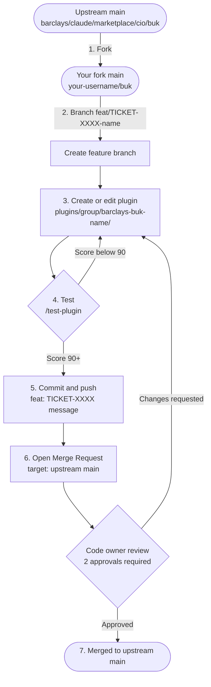

# Contributing a Plugin to the BUK Marketplace

This guide covers the **human process** for contributing a plugin — from idea to merged code. For the technical authoring reference (file structure, agent templates, principles checklist) see [docs/templates/AUTHORING.md](docs/templates/AUTHORING.md).

---

## Before You Start

### What qualifies as a plugin?

A plugin **qualifies** when it represents:

- A distinct **professional role** with domain standards to enforce (e.g. API Engineer, QA Engineer, Accessibility Auditor)
- A **platform-specific capability** where tooling or patterns differ meaningfully (e.g. SDF frontend, iOS, Android)
- A **migration toolkit** with a well-scoped target (e.g. SDK2→SDK3)
- A **meta-tool** supporting plugin or project operations (e.g. testing toolkit, scaffold)

A plugin does **NOT** qualify when:

- It is a one-off script → create a `command` instead
- It is pure standards content → add a `skill` to `barclays-buk-standards` instead
- It duplicates an existing plugin's scope → extend the existing plugin
- It has no domain knowledge, only workflow sequencing → that belongs in a `command`

### Who can contribute?

Any engineer in BUK CIO. A Principal Engineer must sign off before development begins (Step 1 below).

---

## Step 1 — Engage a Principal Engineer

Before writing any code, align with a Principal Engineer on the value, scope, and placement of your plugin.

**Why:** To avoid duplicating existing plugins, misplacing domain knowledge, or building something that won't get adopted.

**How:**
- Book a 30-minute alignment call
- Bring a short one-pager covering: the problem being solved, the proposed agent name, and who the target users are
- Check the [existing plugin catalogue](README.md#available-plugins) beforehand — confirm your idea isn't already covered

**Output of this step:**
- Green light from the Principal Engineer
- Agreed plugin group (`discovery`, `frontend`, `backend`, `quality`, `tooling`, `migration`, or `infrastructure`)
- JIRA project assigned (used in Step 3)

---

## Step 2 — Follow the Plugin Development Guidelines

Build your plugin against the documented standards. Do not start building until Step 1 is complete.

**Technical authoring reference:** [docs/templates/AUTHORING.md](docs/templates/AUTHORING.md)

**Governing principles:** [docs/plugin-principles.md](docs/plugin-principles.md) — all 7 principles must be satisfied before piloting

**Key conventions:**
- Plugin name: `barclays-buk-<name>` (lowercase, hyphens)
- Location: `plugins/<group>/barclays-buk-<name>/`
- Manifest: `.claude-plugin/plugin.json` with `"dependencies": ["barclays-buk-standards"]`
- Agent: `agents/<name>-agent.md` with explicit `## Your Inputs`, `## Your Outputs`, and `## Flags` sections
- Skills: `skills/<skill-name>/SKILL.md` with owner, review trigger, and `## Agent Self-Check` checklist

**Quality gate:** Run the plugin tester before moving to pilot:

```
/test-plugin ./plugins/<group>/barclays-buk-<name>
```

A score of **90 or above** is required before piloting. Fix any issues and re-run. Do not pilot a plugin that has not passed the tester.

---

## Step 3 — Get a JIRA Ticket

Once the Principal Engineer has signed off and you have a working plugin draft, raise a JIRA ticket.

**Raise a ticket in the agreed JIRA project (e.g. PLATENG) with:**
- Summary: short description of the plugin
- Description: problem being solved, proposed agent capabilities, pilot team
- Acceptance criteria: what "done" looks like (pilot complete, stats mechanism in place, MR merged)
- Target pilot team: who will test the plugin in Step 4

**Traceability conventions:**
- Commit messages must reference the ticket: `feat: TICKET-XXXX short description`
- MR title must also include the ticket ID
- This links your commits and MR back to the agreed requirement

---

## Step 4 — Prove the Work with a Small Community

Before requesting a main-branch MR review, pilot the plugin with real users on real tasks.

**How to run a pilot:**
- Identify 2–3 pilot users: a squad, a chapter, or a pairing session works well
- Run the plugin against actual work tasks (not toy examples)
- Collect qualitative feedback: what worked, what hallucinated, what was missing

**What to iterate on based on feedback:**
- Fix `## Flags` sections — update placeholder skills, remove false assumptions
- Tighten `## Your Outputs` — make outputs more precise if users found them vague
- Add domain edge cases to the `## Agent Self-Check` checklist

**Evidence required in your MR description:**
- Summarise what the pilot covered and what was changed as a result
- This is a required field in the MR checklist (Step 6)

Pilot completion is a prerequisite for requesting code owner review on the main-branch MR.

---

## Step 5 — Gather Stats by Default

Every plugin must include a usage instrumentation mechanism from day one. Stats inform the review cadence (per [Principle 6](docs/plugin-principles.md)) and demonstrate adoption when requesting production status.

**Minimum stats to collect:**
- Invocation count (how often the plugin is used)
- Flag frequency (how often the agent raises a `## Flags` item)
- Self-check pass/fail rate (how often the agent's checklist passes on first attempt)

**How to instrument:**

Add a `## Usage notes` section to the agent file that prompts the agent to surface key events at the end of each run:

```markdown
## Usage notes

At the end of every run, report:
- Task type completed
- Output artefacts produced
- Any Flags raised and why
- Self-check items that did not pass
```

**During pilot (Step 4):** Gather stats via manual tally, a shared Notion page, or a team Slack thread.

**In production:** Hook into the agreed observability platform once the plugin is merged. Stats must be reviewed at the plugin's defined review cadence.

---

## Step 6 — Fork, Build, Test & Raise an MR

The full lifecycle from forking the repo to a merged plugin:



---

### 6.1 — Fork the Repo

**Why fork instead of cloning directly?**
You don't have write access to the upstream repo. A fork gives you your own copy on GitLab where you can push freely, then propose changes back via an MR.

**First-time setup:**

1. Open the upstream repo in your browser:
   ```
   https://app.gitlab.barcapint.com/barclays/claude/marketplace/cio/buk
   ```
2. Click **Fork** (top right) → select your personal namespace → click **Fork project**
3. Clone your fork to your machine:
   ```bash
   git clone git@app.gitlab.barcapint.com:<your-username>/buk.git
   cd buk
   ```
4. Add the upstream as a second remote named `upstream`:
   ```bash
   git remote add upstream git@app.gitlab.barcapint.com:barclays/claude/marketplace/cio/buk.git
   ```
5. Verify your remotes are correct:
   ```bash
   git remote -v
   # origin    git@app.gitlab.barcapint.com:<your-username>/buk.git (fetch)
   # origin    git@app.gitlab.barcapint.com:<your-username>/buk.git (push)
   # upstream  git@app.gitlab.barcapint.com:barclays/claude/marketplace/cio/buk.git (fetch)
   # upstream  git@app.gitlab.barcapint.com:barclays/claude/marketplace/cio/buk.git (push)
   ```

**If you already have a fork from a previous contribution**, sync it before starting new work:

```bash
git checkout main
git fetch upstream
git merge upstream/main
git push origin main   # keep your fork's main up to date
```

---

### 6.2 — Create a Branch

Always branch from the latest upstream `main`, not from your fork's potentially stale `main`:

```bash
git fetch upstream
git checkout -b feat/TICKET-XXXX-short-description upstream/main
```

**Branch naming rules:**

| Pattern | Example |
|---------|---------|
| New plugin | `feat/PLATENG-9100-api-engineer-plugin` |
| Edit existing plugin | `feat/PLATENG-9200-update-accessibility-skill` |
| Bug fix | `fix/PLATENG-9300-agent-output-format` |

**Do not** branch from `origin/main` directly — it may be behind upstream.  
**Do not** commit directly to `main` on your fork.

---

### 6.3 — Create or Edit the Plugin

#### Creating a new plugin

Create the directory structure under the agreed plugin group:

```
plugins/<group>/barclays-buk-<name>/
├── .claude-plugin/
│   └── plugin.json          ← manifest (name, version, dependencies)
├── agents/
│   └── <name>-agent.md      ← at least one agent (required)
├── skills/                  ← optional: domain knowledge specific to this plugin
│   └── <skill-name>/
│       └── SKILL.md
├── commands/                ← optional: workflow orchestration
│   └── <name>.md
└── README.md                ← what the plugin does and how to use it
```

Use the templates in `docs/templates/` as your starting point — copy and rename, do not write from scratch:

| Template | Copy to | Purpose |
|----------|---------|---------|
| [docs/templates/plugin.json.template](docs/templates/plugin.json.template) | `.claude-plugin/plugin.json` | Manifest — name, version, dependencies |
| [docs/templates/agent.md.template](docs/templates/agent.md.template) | `agents/<name>-agent.md` | Agent — inputs, outputs, flags, principles note |
| [docs/templates/skill.md.template](docs/templates/skill.md.template) | `skills/<name>/SKILL.md` | Skill — source attribution, standards, self-check |

**Minimum required `plugin.json`:**

```json
{
  "name": "barclays-buk-<name>",
  "description": "One sentence describing what this plugin does.",
  "version": "0.1.0",
  "author": {
    "name": "Barclays BUK",
    "email": "barclaysai@barclays.com"
  },
  "dependencies": ["barclays-buk-standards"]
}
```

> Do **not** declare `agents`, `skills`, or `commands` fields in the manifest — Claude Code auto-discovers them from the directories.

**Agent file — required sections:**

```markdown
---
name: <plugin-name>-agent
description: One or two sentences. What problem does this agent solve?
model: sonnet
tools: Read, Write, Edit, Glob, Bash
owner: <your team or name>
skills:
  - barclays-buk-standards:accessibility   # only load what you need
  - barclays-buk-standards:security
capabilities:
  - Generates X from Y
  - Applies Z standard to every output
---

## Your Inputs
<!-- List every input the agent needs. Be explicit — no assumed context. -->

## Your Outputs
<!-- List every file or artefact the agent produces, one per bullet. -->

<!-- Step-by-step implementation (3–6 steps) -->

## Flags
<!-- What the agent must flag when uncertain: placeholder skills, missing inputs, decisions taken. -->

## Principles compliance note
<!-- Confirm Principles 4 (independently invocable), 5 (transparent), 7 (no workflow enforcement). -->
```

**Finally**, register your plugin in `.claude-plugin/marketplace.json` so it appears in `/marketplace browse`:

```json
{
  "name": "barclays-buk-<name>",
  "group": "<group>",
  "status": "draft",
  "path": "plugins/<group>/barclays-buk-<name>"
}
```

#### Editing an existing plugin

1. Locate the plugin under `plugins/<group>/barclays-buk-<name>/`
2. Make your changes to the relevant agent, skill, or command file
3. Bump the version in `plugin.json` according to the change type:

   | Change | Version bump | Example |
   |--------|-------------|---------|
   | Fix wording, correct a self-check item | Patch | `0.1.0` → `0.1.1` |
   | Add a new agent, skill, or command | Minor | `0.1.0` → `0.2.0` |
   | Change inputs/outputs (breaking) | Major | `0.1.0` → `1.0.0` |

4. Do **not** fork the plugin to add domain-specific rules — use the skill extension pattern in [docs/shared-standards-approach.md](docs/shared-standards-approach.md)

---

### 6.4 — Test the Plugin

**Run the full scored test before pushing anything:**

```
/test-plugin ./plugins/<group>/barclays-buk-<name>
```

A score of **90 or above** is required to proceed. The tester checks four categories:

| Category | Points | What it checks |
|----------|--------|----------------|
| Structure | 40 | Valid JSON manifest, declared files exist, naming conventions |
| Content | 40 | Agent frontmatter complete, capabilities listed, skill Quick Start present, commands valid |
| Schema compliance | 10 | `plugin.json` passes JSON schema validation |
| BUK compliance | 10 | `barclays-buk-` prefix, `barclays-buk-standards` dependency, 7 principles satisfied |

**Other test commands:**

```bash
# Quick structural check — no score, fast feedback
/validate-plugin ./plugins/<group>/barclays-buk-<name>

# Detailed per-check breakdown — shows exactly what failed and why
/test-plugin ./plugins/<group>/barclays-buk-<name> --report
```

**Common failures and fixes:**

| Failure | Fix |
|---------|-----|
| Missing `## Your Inputs` section | Add the section to your agent file |
| Missing `## Flags` section | Add the section to your agent file |
| `dependencies` missing `barclays-buk-standards` | Add it to `plugin.json` |
| Agent name doesn't match plugin name | Rename agent to `<plugin-name>-agent.md` |
| No `owner:` field in agent frontmatter | Add `owner: <your team>` |
| Skill missing `## Agent Self-Check` | Add at least 5 binary checklist items |

Re-run `/test-plugin` after each fix. Do not push until the score is 90+.

---

### 6.5 — Commit and Push

**Stage only the files you have changed** — do not use `git add .`:

```bash
# New plugin
git add plugins/<group>/barclays-buk-<name>/
git add .claude-plugin/marketplace.json

# Editing an existing plugin
git add plugins/<group>/barclays-buk-<name>/agents/<name>-agent.md
git add plugins/<group>/barclays-buk-<name>/.claude-plugin/plugin.json
```

**Commit with the JIRA ticket in the message:**

```bash
git commit -m "feat: TICKET-XXXX short description of what changed"
```

Commit message conventions:

| Prefix | When to use |
|--------|------------|
| `feat:` | New plugin or new capability added to an existing plugin |
| `fix:` | Bug fix or correction to an existing plugin |
| `chore:` | Version bump, formatting, no behaviour change |

**Push to your fork** (not upstream):

```bash
git push origin feat/TICKET-XXXX-short-description
```

If the push is rejected because your branch is behind, rebase rather than force-push:

```bash
git fetch upstream
git rebase upstream/main
git push origin feat/TICKET-XXXX-short-description
```

---

### 6.6 — Open the Merge Request

**In GitLab UI:**

1. Go to your fork: `https://app.gitlab.barcapint.com/<your-username>/buk`
2. You will see a prompt **"Create merge request"** for your recently pushed branch — click it
3. Set the target:
   - **Source branch:** `feat/TICKET-XXXX-short-description` on `<your-username>/buk`
   - **Target project:** `barclays/claude/marketplace/cio/buk` ← important, check this is upstream not your fork
   - **Target branch:** `main`
4. Fill in the title: `feat: TICKET-XXXX short description`
5. Fill in the description using the template below
6. Assign the MR to yourself
7. In the **Reviewers** field, tag the code owners (see [CODEOWNERS](CODEOWNERS))
8. Click **Create merge request**

**Before raising the MR, confirm all of the following:**

- [ ] `/test-plugin` scores 90 or above
- [ ] All 7 principles compliant (see [docs/plugin-principles.md](docs/plugin-principles.md))
- [ ] Pilot completed — summary of pilot included in MR description (Step 4)
- [ ] Stats mechanism in place (Step 5)
- [ ] JIRA ticket linked in MR description
- [ ] Entry added or updated in `.claude-plugin/marketplace.json`

**MR description template:**

```markdown
## What
Brief description of the plugin and what it does.

## Why
Problem being solved. Link to JIRA ticket: TICKET-XXXX

## Pilot summary
Who piloted it, what tasks were run, what was iterated as a result.

## Stats mechanism
How usage will be tracked (Flags section, Usage notes section, or external platform).

## Checklist
- [ ] /test-plugin score: XX/100
- [ ] All 7 principles compliant
- [ ] Pilot complete
- [ ] Stats in place
- [ ] marketplace.json updated
```

**After the MR is raised:**

- 2 approvals are required per [CODEOWNERS](CODEOWNERS)
- If reviewers request changes: make the fixes on your branch, re-run `/test-plugin`, push — the MR updates automatically
- Do not force-push after review has started — use additional commits so reviewers can see what changed
- Once approved, a code owner will merge to `main`
