# BUK Plugin Architecture

## Plugin dependency map

```mermaid
graph TB

    subgraph standards
        STD[barclays-buk-standards]
    end

    subgraph discovery
        PM[barclays-buk-product-manager]
        UXD[barclays-buk-ux-designer]
        CW[barclays-buk-copywriter]
        SAR[barclays-buk-solution-architect]
        SCR[barclays-buk-security-architect]
    end

    subgraph frontend
        UIE[barclays-buk-ui-engineer]
        SDF[barclays-buk-ui-engineer-sdf]
        IOS[barclays-buk-ui-engineer-ios]
        ANDR[barclays-buk-ui-engineer-android]
        WBE[barclays-buk-ui-engineer-web]
    end

    subgraph backend
        APE[barclays-buk-api-engineer]
        DNE[barclays-buk-data-engineer]
    end

    subgraph quality
        QEN[barclays-buk-quality-engineer]
        AUD[barclays-buk-accessibility-auditor]
        REL[barclays-buk-reliability-engineer]
        INC[barclays-buk-incident-manager]
    end

    PM --> STD
    UXD --> STD
    CW --> STD
    SAR --> STD
    SCR --> STD
    UIE --> STD
    SDF --> STD
    IOS --> STD
    ANDR --> STD
    WBE --> STD
    APE --> STD
    DNE --> STD
    QEN --> STD
    AUD --> STD
    REL --> STD
    INC --> STD

    SDF -.->|delegates to| UIE
    IOS -.->|delegates to| UIE
    ANDR -.->|delegates to| UIE
    WBE -.->|delegates to| UIE
```

## Skills loaded per plugin

| Plugin | Skills |
|---|---|
| barclays-buk-product-manager | consumer-duty, vulnerable-customers, customer-engagement, governance |
| barclays-buk-ux-designer | accessibility, consumer-duty, vulnerable-customers, ux, brand |
| barclays-buk-copywriter | accessibility, consumer-duty, vulnerable-customers, customer-engagement, brand |
| barclays-buk-solution-architect | api-design, security |
| barclays-buk-security-architect | security |
| barclays-buk-ui-engineer | accessibility, security |
| barclays-buk-ui-engineer-sdf | figma (shared), accessibility, security |
| barclays-buk-ui-engineer-ios | figma (shared), accessibility, security, security-ios (extension) |
| barclays-buk-ui-engineer-android | figma (shared), accessibility, security |
| barclays-buk-ui-engineer-web | figma (shared), accessibility, security |
| barclays-buk-api-engineer | api-design, security |
| barclays-buk-data-engineer | security |
| barclays-buk-quality-engineer | accessibility, security, testing |
| barclays-buk-accessibility-auditor | accessibility |
| barclays-buk-reliability-engineer | security |
| barclays-buk-incident-manager | security |

## Skills inventory

| Skill | Status | Source |
|---|---|---|
| accessibility | ✅ Full | Barclays Digital Accessibility Standards V3.0 (WCAG 2.2 AA), Sep 2023 |
| security | ✅ Full | Secure Coding Practices v1.2.6 |
| consumer-duty | ✅ Full | Barclays CDA docs + FCA FG22/5 |
| vulnerable-customers | ✅ Full | FCA FG21/1, Feb 2021 |
| customer-engagement | ✅ Full | Customer Engagement Standard v7.2 |
| api-design | ✅ Full | Digital API Framework (DAF) |
| performance | ✅ Full | BUK VPT NFR platform/channel targets |
| testing | 🚧 Placeholder | Needs BUK testing standards source |
| governance | 🚧 Placeholder | Needs BUK governance standards source |
| ux | 🚧 Placeholder | Needs BUK UX standards source |
| brand | 🚧 Placeholder | Needs Barclays brand guidelines source |
| observability | 🚧 Placeholder | Needs OPAL/observability standards source |
| data | 🚧 Placeholder | Needs BUK data standards source |
| mobile | 🚧 Placeholder | Needs BUK mobile standards source |
| infrastructure | 🚧 Placeholder | Needs BUK infrastructure standards source |
| adr | 🚧 Placeholder | Needs ADR template and conventions source |
