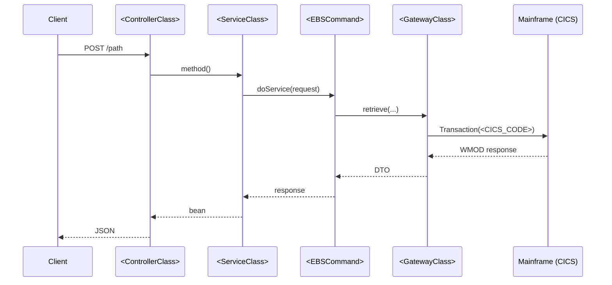

# Per-Service Documentation Template

Each `docs/mts/service-doc-<ServiceName>-<method>.md` file MUST follow this 9-section structure.
Do NOT remove any section. Do NOT add code blocks with Java source. Use JSON for sample request/response.

For transport-variant details in Section 6, see `reference/per-service-doc-sections.md`.

---

```markdown
# MTS Service Documentation: <ServiceName>.<methodName>

## 1. Quick Reference

| Key | Value |
|-----|-------|
| Service | `<ServiceName>` / `<method>` |
| Transport | <transport classification> |
| EBS JAR(s) | `<ebs_artifact:version>` |
| EGS JAR(s) | `<egs_artifact:version>` |
| CGS JAR(s) | `<cgs_artifact:version>` (or `—` if none) |
| CICS Code | `<code>` |
| Messaging Name | `<messaging_name>` |
| Gateway | `<GatewayClass.method()>` |
| Entry Point | `<HTTP_METHOD /path>` |
| Source Systems | <system codes> |

**TDL Tables:** <comma-separated list — CODE_PATH_TDL_TABLES only>

**DataGroups:** <comma-separated list — CODE_PATH_DATAGROUPS only>

> **Note:** The `<TransactionClass>` supports <N> additional DataGroups (see Section 6 — DataGroup Chain). The <M> listed above are the only ones sent by `<CallingMethod>` in the <path-name> path.

## 2. Overview

Brief (2-4 sentence) description of what this service call retrieves or does.
Name the service, method, transport, and purpose in prose.
Do NOT include a Service Identity table — all identity data is in Section 1.

## 3. Call Flow

One Mermaid `sequenceDiagram` showing the full flow from REST endpoint through EBS internals
to gateway/mainframe interactions. Include a note stating whether the service has a single
entry point or multiple.

Do NOT include a `graph TD` caller hierarchy or numbered text call chain — the sequence
diagram captures all this information.



> **Entry points:** Single / Multiple — <detail>

## 4. Request & Response

### Request

One canonical JSON template. If multiple doService calls exist with near-identical requests,
show ONE template and a variations table listing what differs per call.

```json
{
  "customerId": "12345678",
  "dataGroups": ["ENUM_A", "ENUM_B"],
  "fullRetrieveRequired": false
}
```

#### Request Field Descriptions

| Field | Type | Source | Description |
|-------|------|--------|-------------|
| customerId | String | Path variable from REST request | Primary customer identifier |
| dataGroups | CustomerDataGroup[] | Hardcoded in service | DataGroups to retrieve |
| fullRetrieveRequired | boolean | Hardcoded false | Whether to retrieve full data set |

### Response

Show ONLY populated fields for this service's DataGroups. Omit empty arrays, null values,
and fields not populated by the in-scope DataGroups.

> Other fields not populated by this service's DataGroups are omitted.

```json
{
  "fieldA": "value",
  "fieldB": 42,
  "nestedObject": {
    "innerField": "value"
  }
}
```

## 5. End-to-End Field Mapping

Full traceability table showing every response field traced through 4 system layers.

### In-Scope Fields (gateway + derived)

| <Transport> Source | Gateway DTO (<ActualDTOClass>) | Response Bean (<ActualBeanClass>) | REST Response (Type) | Origin | Description |
|---|---|---|---|---|---|
| WMOD-XXXX-PRM (TDLXXXX) | dtoField | beanField | restField (String) | gateway | Description |
| — | derivedField | computedField | outputField (int) | gateway > derived | Computed from array |

### Out-of-Scope Fields

| <Transport> Source | Gateway DTO (<ActualDTOClass>) | Response Bean (<ActualBeanClass>) | REST Response (Type) | Origin | Description |
|---|---|---|---|---|---|
| — | — | externalField | externalField (String) | external-service | From another service |
| — | — | contextField | contextField (String) | request-context | Echoed from request |

**Origin values:** `gateway`, `gateway > derived`, `derived`, `full-retrieval-only`, `external-service`, `controller`, `request-context`, `error-field`, `unknown`

## 6. Backend Mappings

This section is transport-variant. Only ONE variant applies per service.

Available variants:
- **Variant A:** Mainframe Table Mappings (`mainframe-mq`)
- **Variant B:** SOAP Service Mappings (`soap-stub` / `soap-eao`)
- **Variant C:** Database Mappings (`oracle-db-direct` / `db2-reference`)
- **Variant D:** CMOD Document Mappings (`cmod-odwek`)
- **Variant E:** Hybrid Service Mappings (`tcv-hybrid`)
- **Variant F:** SCV Integration Mappings (`scv`)
- **Variant G:** REST API Connection (`already-api-rest` / `already-api-direct-http`)
- **Variant H:** Data Source (`reference-data-only` / `framework`)

See `reference/per-service-doc-sections.md` for complete variant templates.

### Example: Variant A (Mainframe Table Mappings)

#### Transaction Identity

| Type | Name | Source |
|------|------|--------|
| CICS Programme Code | TDLQCU | Transaction.getName() |
| ROP/RIP Files | CUS_ALL_RETRIEVE_VO.ROP/.RIP | EGS JAR riprop/ |

#### Command Class
`com.barclays.ebs.command.CustomerCommand`

#### Gateway Calls

| Gateway Class | Method | Transaction Class | Purpose |
|---------------|--------|-------------------|---------|
| CustomerGateway | findByPrimaryKey() | CustomerAllRetrieveTransaction | Retrieve customer data |

#### DataGroup Chain

```
CustomerCommand
  -> CustomerGateway.findByPrimaryKey()
    -> CustomerAllRetrieveTransaction(TDLQCU)
      -> DataGroups requested:
        DataGroup.ENUM_A -> WMID-XXXX-PRM -> TDLXXXX
        DataGroup.ENUM_B -> WMID-YYYY-PRM -> TDLYYYY
```

#### Request Field Inventory (WMID)

| WMID Field | Source | TDL Table | Notes |
|------------|--------|-----------|-------|
| WMID-XXXX-KEY | customerId | TDLXXXX | Primary key |

> **Transaction capability reference:** The `<TransactionClass>` supports <N> WMID fields in total.

#### Response Field Inventory (WMOD)

| WMOD Field | Java Domain Field | Description |
|------------|-------------------|-------------|
| WMOD-XXXX-FIELD | dtoField | Description of field |

#### TDL Tables Accessed

| TDL Table | Access Type | Path | Description |
|-----------|-------------|------|-------------|
| TDLXXXX | Read | counter | Description |

#### Mainframe Program Codes

| Step | Program Code | Version Code | Transaction Name | Transaction Class | Description |
|------|-------------|--------------|------------------|-------------------|-------------|
| 1 | TDLQCU | 01 | CUS_ALL_RETRIEVE_VO | CustomerAllRetrieveTransaction | Customer retrieval |

#### Verification Confidence

**Verified from source** — extracted from EBS source JAR.

## 7. Dependencies

| Artifact | Group ID | Version | Jar Type | Sources Available | Purpose |
|----------|----------|---------|----------|-------------------|---------|
| ebs-customer | com.barclays.ebs | 1.0 | EBS | Yes | Customer service |
| egs-customer-gateway | com.barclays.egs | 1.0 | EGS | Yes | Gateway to mainframe |

## 8. Summary

One paragraph summarising the service's role in the overall application flow,
its transport mechanism, key data groups accessed, and downstream consumers.

## 9. Migration Complexity Indicators

| Indicator | Value | Detail |
|---|---|---|
| Business Logic Complexity | LOW / MEDIUM / HIGH | <line count, class names> |
| Sub-Service Calls | <count> | <list of gateways/services called> |
| Security Patterns | <list or "None detected"> | <pattern + class where found> |
| ODS Switch State | O / M / U / B / "No ODS switch detected" | <switch logic location> |
| Batch Pattern | Yes / No | <detail if yes> |
| Error Response Codes | <count> (<breakdown>) / "Data not available" | <Response class name> |
| Write Complexity | SIMPLE / COMPLEX / N/A | <detail if complex> |
| Secondary Backends | <list or "None"> | <e.g., Teradata DW (egs-odsmf-ukba)> |

**Data source:** Extracted from MIS source repo, EBS/EGS JARs, application.properties, and EAO classes during discovery (Step S.7n).
If any indicator cannot be determined (e.g., MIS source not cloned), show: `"Data not available — <reason>"`.
```
