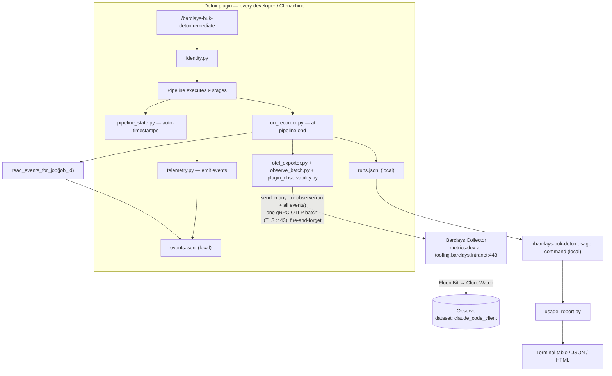

# Detox Telemetry System

> Self-contained observability for the Detox CWE remediation pipeline.
> Zero-config for developers — just run `/barclays-buk-detox:remediate` and everything records automatically.

---

## Table of Contents

- [Capabilities](#capabilities)
- [Architecture](#architecture)
- [Data Flow](#data-flow)
- [Data Models](#data-models)
  - [1. OTel Event](#1-otel-event)
  - [2. Run Record](#2-run-record)
  - [3. Identity](#3-identity)
  - [4. Pipeline State](#4-pipeline-state)
  - [5. Website Export](#5-website-export)
- [Event Types](#event-types)
- [Storage](#storage)
- [Configuration](#configuration)
- [Privacy Rules](#privacy-rules)
- [Architecture Design](#architecture-design)

---

## Capabilities

| # | Capability | Component | File | Description |
|---|---|---|---|---|
| 1 | **Event Emission** | Telemetry Emitter | `scripts/telemetry/telemetry.py` | Appends OTel-native structured JSON events to local JSONL log. Fire-and-forget — never blocks the pipeline. |
| 2 | **Identity Resolution** | Identity Resolver | `scripts/telemetry/identity.py` | Detects **WHO** ran the pipeline (user name, email, CI context) and **WHAT REPO** is being targeted (name, URL). |
| 3 | **Run Recording** | Run Recorder | `scripts/telemetry/run_recorder.py` | Builds one denormalized summary line per pipeline run with all metrics — powers the dashboard. |
| 4 | **Observe Export** | Observe Exporter | `scripts/telemetry/otel_exporter.py` + `scripts/telemetry/observe_batch.py` + `scripts/telemetry/plugin_observability.py` | At run end, sends the run summary + all per-phase events to Barclays Observe in one gRPC OTLP batch. Deps (grpcio/opentelemetry in `~/.claude/observe_venv`) are a CHECK-ONLY preflight prerequisite — pre-provisioned, not auto-installed. |
| 6 | **Usage Reporting** | Aggregation Engine | `scripts/telemetry/usage_report.py` | Computes aggregated metrics and renders terminal table, machine-readable JSON, or executive HTML report. |
| 7 | **Dashboard Command** | CLI Entrypoint | `commands/usage.md` | `/barclays-buk-detox:usage` — user-facing command with `--period`, `--group-by`, `--format`, `--output` flags. |
| 8 | **Telemetry Contract** | Agent Skill | `skills/observability/telemetry-contract/SKILL.md` | Teaches agents the event schema, emission rules, privacy constraints, and self-check checklist. |

---

## Architecture

### Component Overview

| Layer | Script | Role | I/O |
|---|---|---|---|
| **Identity** | `scripts/telemetry/identity.py` | Resolve WHO + WHAT REPO | JSON stdin → `{"identity": {...}}` |
| **Collect** | `scripts/telemetry/telemetry.py` | Emit / query / summarize granular events | JSON stdin → append to `events.jsonl` |
| **Helper** | `scripts/utils/common.py` → `emit_telemetry_event()` | Fire-and-forget wrapper available to all scripts | `(event_type, attributes, severity) → None` |
| **State** | `scripts/pipeline_state.py` | Auto-inject phase timestamps on status transitions | JSON stdin → update state file with `fcntl` locking |
| **Record** | `scripts/telemetry/run_recorder.py` | Build + write denormalized run summary | JSON stdin → append to `runs.jsonl` + trigger export |
| **Export** | `scripts/telemetry/otel_exporter.py` + `observe_batch.py` + `plugin_observability.py` | Send run summary + all per-phase events to Barclays Observe in one gRPC batch | JSON stdin → `send_many_to_observe` (gRPC OTLP) |
| **Export** | `scripts/telemetry/export_telemetry.py` | Generate website-consumable JSON | JSON stdin → write `usage-report.json` |
| **Report** | `scripts/telemetry/usage_report.py` | Aggregate metrics, render table/json/html | JSON stdin → formatted output |

### Orchestrator Integration

Only the **orchestrator agent** (`agents/detox-orchestrator-agent.md`) interacts with telemetry directly:

| When | Action | Script Called |
|---|---|---|
| **Pipeline start** (after preflight, before Stage 1) | Resolve identity | `identity.py` with `{"project_path": "..."}` |
| **Pipeline end** (after Stage 9 or on fatal failure) | Record run summary + export to OTel | `run_recorder.py` with `{"action": "record", "state_path": "{project_path}/.detox/state.json", "identity": {...}, "ended_at": "..."}` |

Worker agents (fix, parser, validator, scan, test, report) do **not** emit telemetry directly — the orchestrator owns the telemetry lifecycle.

### State File — Source of Truth for Run Counts

Run counts are read from the pipeline state file `{project_path}/.detox/state.json`, never
from a summary the orchestrator writes by hand:

| Who | Writes |
|---|---|
| `prepare_pipeline.py` (Stages 0-3) | Creates the file: `job_id`, every parsed finding in `vulnerabilities`, `infra/manual/hybrid_findings`, phases 1-3 `completed`; returns `job_id` + `state_path` |
| Orchestrator via `pipeline_state.py` | `update` (fields, phase status) and `append` (`fix_results`, `test_results`, `evidence_records`, `unresolved_items`) as each result is known |
| `run_recorder.py` | Reads the file (`state_path`, else `{state.project_path}/.detox/state.json`). A pasted `state` only fills fields the file leaves empty |

`run_recorder.py` adds to `flags_raised`:

| Flag | Meaning | Banner |
|---|---|---|
| `state_incomplete` | A PR or fix results were recorded but no findings — the counts were lost | `⚠️  Exported to Observe (incomplete counts)` instead of ✅ |
| `state_file_missing` | No state file could be read; counts come only from the pasted `state` | unchanged |

### Phase Timestamp Auto-Injection

`pipeline_state.py` `update` injects timestamps and emits a phase event (to `events.jsonl`)
whenever a phase status changes; `prepare_pipeline.py` does the same for phases 1-3:

| Status Transition | Auto-Injected Fields | Event |
|---|---|---|
| Phase → `in_progress` | `phases.<N>.started_at` = current UTC ISO8601 (if not set) | `phase.started` |
| Phase → `completed` / `skipped` / `failed` | `phases.<N>.ended_at` = current UTC ISO8601 (if not set) | `phase.completed` / `phase.skipped` / `phase.failed` |

Per-phase `duration_ms` is computed from these timestamps by `run_recorder.py`. Events are
exported with the run summary at pipeline end, in the same batch.

---

## Data Flow

| Step | Action | Script | Config Required |
|---|---|---|---|
| 1 | Developer runs `/barclays-buk-detox:remediate` | — | None |
| 2 | Orchestrator resolves user + repo identity | `identity.py` | None (auto) |
| 3 | Stages 0-3 write the state file (findings, phases 1-3) | `prepare_pipeline.py` | None (auto) |
| 4 | Stages 4-9 record results and phase changes in the state file; each phase change is timestamped and emitted as an event | `pipeline_state.py` → `telemetry.py` | None (auto) |
| 5 | Pipeline ends; run summary built from the state file | `run_recorder.py` | None (auto) |
| 6 | Auto-export sends run summary + all per-phase events to Barclays Observe in one gRPC batch | `otel_exporter.py` + `observe_batch.py` + `plugin_observability.py` | None (endpoint from settings.json or detox default, always on) |
| 7 | Barclays Collector routes to Observe (FluentBit → CloudWatch → `claude_code_client`) | Platform-managed | None (managed infra) |
| 9 | User queries local data via `/barclays-buk-detox:usage` command | `usage_report.py` | None (auto) |

---

## Data Models

### 1. OTel Event

**Storage:** `~/.detox/telemetry/events.jsonl` (one JSON line per event)

Granular per-event log — every phase transition, fix attempt, validation result, and test outcome.

| Field | Type | Example | Source |
|---|---|---|---|
| `Timestamp` | ISO8601 string | `"2026-08-27T14:30:00.123Z"` | `datetime.now(utc)` |
| `SeverityText` | string | `"INFO"` / `"WARN"` / `"ERROR"` / `"FATAL"` | Event-specific |
| `SeverityNumber` | int | `9` (INFO), `13` (WARN), `17` (ERROR), `21` (FATAL) | OTel severity map |
| `Body` | string | `"Event: pipeline.started"` | Human-readable description |
| `TraceId` | 32-char hex | `"a1b2c3d400000000..."` | `job_id.ljust(32, '0')[:32]` |
| `SpanId` | 16-char hex | `"e7f3a9b1c2d4e5f6"` | `md5(f"{job_id}-phase-{N}")[:16]` |
| **Resource** | object | | |
| `.service.name` | string | `"detox"` | Hardcoded |
| `.service.version` | string | `"2.6.2"` | Read from `.claude-plugin/plugin.json` via `scripts/telemetry/version.py` |
| `.deployment.environment` | string | `"local"` / `"ci"` | Auto-detected from `CI`, `CI_JOB_ID`, `BUILD_NUMBER`, `GITHUB_ACTIONS` env vars |
| `.barclays_cio` | string \| null | `"DIGITAL"` | `barclays_cio` from `~/.claude/settings.json` `OTEL_RESOURCE_ATTRIBUTES` (mandatory Barclays user setup); null if absent |
| **Attributes** | object | | |
| `.detox.event_type` | string | `"fix.applied"` | One of 17 event types (see [Event Types](#event-types)) |
| `.detox.job_id` | string | `"a1b2c3d4"` | Pipeline state |
| `.detox.phase` | int \| null | `4` | Current phase (1–9), or null for root events |
| `.detox.event_id` | 12-char hex | `"f3a9b1c2d4e5"` | `uuid4().hex[:12]` (generated on write) |
| `.detox.user.name` | string | `"Devesh Kumar"` | Caller-supplied (orchestrator passes from `identity.py`) |
| `.detox.cio` | string \| null | `"DIGITAL"` | User's CIO / Business Portfolio, from `barclays_cio`; mirrors Resource `barclays_cio`. Drives adoption-by-CIO reporting |
| `.detox.repo_name` | string | `"my-service"` | Caller-supplied (orchestrator passes from `identity.py`) |
| `.detox.*` | any | *(domain-specific extras)* | Additional attributes passed via event data dict |

> **Note:** `detox.user.name` and `detox.repo_name` are not auto-populated by `build_event()`. They appear only when the calling code includes `user.name` or `repo_name` in the event data dict — the generic merge loop prefixes all extra keys with `detox.`. The orchestrator agent is responsible for including identity data when emitting events.

**Trace/Span ID Generation:**

```python
# All events in one pipeline run share the same TraceId
trace_id = job_id.ljust(32, "0")[:32]

# Each phase gets a unique SpanId
span_id = hashlib.md5(f"{job_id}-phase-{phase}".encode()).hexdigest()[:16]
```

---

### 2. Run Record

**Storage:** `~/.detox/telemetry/runs.jsonl` (one JSON line per pipeline run)

Denormalized summary — powers the `/barclays-buk-detox:usage` dashboard and website export.

| Field | Type | Example | Derived From |
|---|---|---|---|
| **Core** | | | |
| `job_id` | string | `"a1b2c3d4"` | Pipeline state |
| `command` | string | `"remediate"` | Input to run_recorder |
| `started_at` | ISO8601 | `"2026-09-14T10:00:00Z"` | Pipeline state |
| `ended_at` | ISO8601 | `"2026-09-14T10:12:30Z"` | Input or `datetime.now(utc)` |
| `total_duration_ms` | int \| null | `750000` | Computed: `ended_at − started_at` |
| `status` | string | `"completed"` / `"failed"` | Phase statuses or explicit override |
| **Identity** | | | |
| `user_name` | string | `"Devesh Kumar"` | `identity.py` |
| `user_email` | string | `"devesh@barclays.com"` | `identity.py` |
| `cio` | string \| null | `"DIGITAL"` | `identity.py` → `common.get_barclays_cio()` (reads `barclays_cio` from `~/.claude/settings.json`) |
| `ci_job_id` | string \| null | `"12345"` | CI env var |
| `model` | string | `"sonnet"` | Pipeline state |
| **Target** | | | |
| `project_path` | string | `"/path/to/repo"` | Pipeline state |
| `repo_name` | string | `"my-service"` | Identity / path fallback |
| `severity_filter` | string | `"all"` | Pipeline config |
| `dry_run` | bool | `false` | Pipeline config |
| **Vulnerability Metrics** | | | |
| `vulns_total` | int | `12` | `len(vulnerabilities)` |
| `vulns_by_severity` | dict | `{"high": 5, "medium": 7}` | Counted from vulnerability list |
| `vulns_by_type` | dict | `{"code_fix": 10, "infra": 2}` | Counted from vulnerability list |
| `cwes_targeted` | list[str] | `["CWE-79", "CWE-89"]` | Unique CWE IDs from vulnerabilities |
| **Fix Metrics** | | | |
| `fixes_attempted` | int | `12` | `len(fix_results)` |
| `fixes_succeeded` | int | `10` | fix_results where status = `"success"` |
| `fixes_failed` | int | `1` | fix_results where status = `"failed"` |
| `fixes_skipped` | int | `1` | fix_results where status = `"skipped"` |
| `retries_total` | int | `3` | Sum of `retry_count` across all fix_results |
| `fixes_validated_clean` | int | `1` | Fixes that passed BOTH stages (status=success AND validation_passed=true) — the "verified fixed" count |
| `vulns_deferred` | int | `5` | Vulns found but never attempted (deferred). vulns_total = fixes_attempted + vulns_deferred |
| `vulns_deferred_by_reason` | dict | `{"manual":3,"hybrid":1,"out_of_repo":2}` | Stage 8 `state.unresolved_items` bucketed by remediation_type (missing → `unspecified`). Does NOT sum to vulns_deferred; `{}` if the run aborts before Stage 8 |
| `fixes_unverified_by_reason` | dict | `{"still_detected":1,"fix_failed":1}` | WHY not verified — attempted-but-not-clean fixes bucketed by reason; sums to fixes_attempted − fixes_validated_clean |
| `unresolved_vulns` | list[dict] | `[{"vuln_id":"wiz-…","cwe_id":"CWE-937","severity":"high","remediation_type":"dependency","reason":"…"}]` | One entry per unfixed in-scope finding with the LLM's reason (`build_unresolved_vulns`). Exported on `detox.pipeline_run` as `detox.unresolved_vulns` (JSON string) + `detox.unresolved_vulns_count`, and also as one `detox.vuln_unresolved` event each |
| **Remediation Rates** | | | |
| `remediation_rate` | float \| null | `0.25` | fixes_succeeded (edits applied) / vulns_total, null if no vulns |
| `verified_remediation_rate` | float \| null | `0.125` | fixes_validated_clean / vulns_total — strictest success measure, null if no vulns |
| `fix_success_rate` | float \| null | `0.667` | fixes_succeeded / fixes_attempted, null if none attempted |
| `fix_failure_rate` | float \| null | `0.0` | fixes_failed / fixes_attempted, null if none attempted |
| `deferral_rate` | float \| null | `0.625` | (vulns_total − fixes_attempted) / vulns_total, null if no vulns |
| **Validation Metrics** | | | |
| `validation_pass_count` | int | `9` | fix_results where `validation_passed` = true |
| `validation_fail_count` | int | `1` | fix_results where `validation_passed` = false |
| `validation_pass_rate` | float \| null | `0.9` | pass / (pass + fail), null if no validations |
| **Test Metrics** | | | |
| `tests_generated` | int | `8` | `len(test_results)` |
| `tests_passed` | int | `7` | test_results where status = `"success"` |
| `tests_failed` | int | `1` | test_results where status = `"failed"` or `"error"` |
| `test_pass_rate` | float \| null | `0.875` | tests_passed / (tests_passed + tests_failed), null if none executed |
| **PR** | | | |
| `pr_created` | bool | `true` | `bool(state.pr_url)` |
| `pr_url` | string \| null | `"https://gitlab.../mr/42"` | Pipeline state |
| **Usage Profile** | | | |
| `agent_invocations` | int | `15` | Input to run_recorder |
| **Governance** | | | |
| `flags_raised` | list | `["manual_review_needed"]` | Input to run_recorder |
| `self_check_passed` | bool | `true` | Input to run_recorder |
| **Phase Timing** | | | |
| `phases` | dict | `{"1": {"status": "completed", "started_at": "...", "ended_at": "...", "duration_ms": 5000}}` | Per-phase timing from pipeline state |
| `errors` | list | `[{"phase": "4", "error": "..."}]` | Failed phases with error details |
| `plugin_version` | string | `"2.6.2"` | Read from `.claude-plugin/plugin.json` via `scripts/telemetry/version.py` |

---

### 3. Identity

**Resolved by:** `scripts/telemetry/identity.py`

Identity resolution follows a priority chain: **CI env vars → git config → environment fallbacks**.

| Field | Type | Source (Priority Order) |
|---|---|---|
| `user_name` | string | `GITLAB_USER_LOGIN` → `CI_COMMIT_AUTHOR` → `GITHUB_ACTOR` → `BUILD_USER` → `git config user.name` → `$USER` / `$USERNAME` → `"unknown"` |
| `user_email` | string | `GITLAB_USER_EMAIL` → `BUILD_USER_EMAIL` → `git config user.email` → `""` |
| `cio` | string \| null | `common.get_barclays_cio()` → `barclays_cio` in `~/.claude/settings.json` `OTEL_RESOURCE_ATTRIBUTES` (from the mandatory Barclays user setup). `null` if absent. The user's CIO / Business Portfolio, used for adoption-by-CIO reporting. |
| `ci_job_id` | string \| null | `CI_JOB_ID` (GitLab) / `BUILD_NUMBER` (Jenkins) / `GITHUB_RUN_ID` (GitHub Actions) |
| `ci_pipeline_id` | string \| null | `CI_PIPELINE_ID` (GitLab) / `JOB_NAME` (Jenkins) / `GITHUB_RUN_NUMBER` (GitHub Actions) |
| `ci_project_name` | string \| null | `CI_PROJECT_NAME` (GitLab) / `GITHUB_REPOSITORY` last segment (GitHub Actions) — CI only |
| `ci_project_url` | string \| null | `CI_PROJECT_URL` (GitLab only) — CI only |
| `hostname` | string | `socket.gethostname()` |
| `source` | string | `"gitlab_ci"` / `"jenkins"` / `"github_actions"` / `"git_config"` / `"env"` |
| `repo_name` | string | Last path segment of `git remote get-url origin` → `Path(project_path).name` |
| `repo_url` | string | `git remote get-url origin` or `""` |

**CI Detection Logic:**

| CI Platform | Detection Key | Additional Fields |
|---|---|---|
| GitLab CI | `CI_JOB_ID` exists | `ci_project_name`, `ci_project_url` |
| Jenkins | `BUILD_NUMBER` exists | — |
| GitHub Actions | `GITHUB_ACTIONS` exists | `ci_project_name` (from `GITHUB_REPOSITORY`) |

---

### 4. Pipeline State

**Managed by:** `scripts/pipeline_state.py`

The pipeline state is the live document that feeds into the run record at pipeline end. It is a JSON file on disk, updated via dot-path updates with `fcntl` file locking.

| Field | Type | Description |
|---|---|---|
| `version` | int | Schema version (`1`) |
| `job_id` | string | 8-hex-char pipeline run identifier |
| `project_path` | string | Absolute path to target repository |
| `started_at` | ISO8601 | Pipeline start timestamp |
| `jira_id` | string \| null | Associated Jira ticket |
| `model` | string | LLM model used (`"sonnet"`, `"opus"`) |
| `severity_filter` | string | Which severities to fix (`"all"`, `"critical"`, `"high"`) |
| `dry_run` | bool | Preview mode — no actual changes |
| `generate_tests` | bool | Whether to generate security tests |
| `test_mode` | string | Test execution mode (`"fast"`, `"full"`) |
| `branch_name` | string \| null | Git branch for fix commits |
| `phases` | dict | 9 phases, each with `status`, `started_at`, `ended_at`, `duration_ms` |
| `vulnerabilities` | list[dict] | Parsed findings (see `Vulnerability` dataclass in `models.py`) |
| `fix_results` | list[dict] | Fix outcomes (see `FixResult` dataclass in `models.py`) |
| `test_results` | list[dict] | Test outcomes (see `TestRunResult` dataclass in `models.py`) |
| `infra_findings` | list[dict] | Infrastructure-only findings (non-code) |
| `hybrid_findings` | list[dict] | Findings requiring both code + infra changes |
| `manual_findings` | list[dict] | Findings requiring manual human review |
| `unresolved_items` | list[dict] | Stage 8 unresolved items: `{id, cwe_id, remediation_type, unfixed_reason, corrective_action_doc}`. Source of `vulns_deferred_by_reason` and per-finding `detox.unresolved.reason` |
| `report_path` | string \| null | Path to generated remediation report |
| `pr_url` | string \| null | URL of created merge request |

**Pipeline State Actions (via JSON stdin):**

| Action | Input | Description |
|---|---|---|
| `init` | `{"action": "init", "project_path": "..."}` | Create state file with 9 phases, all `"pending"` |
| `update` | `{"action": "update", "state_path": "...", "updates": {"phases.4.status": "completed"}}` | Dot-path updates with `fcntl` locking + auto-timestamps |
| `check_gate` | `{"action": "check_gate", "state_path": "...", "phase": 4, "required_phases": [1,2,3]}` | Verify prerequisites before phase entry |

---

### 5. Website Export

**Generated by:** `scripts/telemetry/export_telemetry.py`

**Storage:** Individual run files in Nexus at `com/barclays/rolb/detox/raw/`. Aggregated client-side by `useTelemetry.ts` in the website.

| Top-Level Key | Sub-Fields | Description |
|---|---|---|
| `_meta` | `schema_version`, `generated_at`, `generated_by`, `plugin_version`, `period`, `source`, `description` | Export metadata for consumers |
| `summary` | `total_runs`, `total_repos_onboarded`, `newly_onboarded_this_period`, `unique_users`, `cwes_remediated`, `remediation_rate`, `fix_success_rate`, `deferral_rate`, `validation_pass_rate`, `test_pass_rate` | KPI summary for dashboard header |
| `repos[]` | `name`, `runs`, `success_rate`, `cwes_fixed`, `unique_users` | Per-repository breakdown (top 10) |
| `onboarding` | `total_repos_onboarded`, `newly_onboarded_this_period`, `repos_with_first_run[]` (name + first_run date) | Adoption tracking |
| `effectiveness` | `cwes_remediated`, `vulns_found_total`, `remediation_rate`, `fix_success_rate`, `fix_failure_rate`, `deferral_rate`, `validation_pass_rate`, `test_pass_rate`, `tests_generated` | Remediation-effectiveness metrics |
| `security_posture` | `top_cwes[]` (cwe + count), `severity_distribution` | CWE frequency and severity breakdown |
| `performance` | `avg_duration_ms`, `median_duration_ms`, `p95_duration_ms`, `min_duration_ms`, `max_duration_ms`, `by_phase` (per-phase median) | Timing analytics |
| `usage` | `total_runs`, `unique_users`, `unique_repos`, `runs_per_day_avg`, `most_active_user`, `most_active_repo` | Adoption and usage frequency |
| `errors` | `failure_count`, `failure_rate`, `by_reason` (top 5), `total_retries` | Pipeline reliability |
| `period` | `start`, `end`, `label`, `days` | Time window for this export |

---

## Event Types

All 17 OTel event types emitted by the Detox pipeline. In Observe each lands as
`detox.<event_type>` (e.g. `pipeline.started` → **`detox.pipeline.started`**);
the run summary is the separate `detox.pipeline_run` event.

| Event Type | When Emitted | Severity | Key Attributes |
|---|---|---|---|
| `pipeline.started` | Orchestrator begins after preflight | INFO | `job_id`, `model`, `repo_name` |
| `pipeline.completed` | Orchestrator finishes successfully | INFO | `job_id`, `total_duration_ms` |
| `pipeline.failed` | Critical phase fails | ERROR | `job_id`, `failed_phase`, `error` |
| `phase.started` | Phase transitions to `in_progress` | INFO | `job_id`, `phase` |
| `phase.completed` | Phase transitions to `completed` | INFO | `job_id`, `phase`, `duration_ms` |
| `phase.skipped` | Phase transitions to `skipped` | INFO | `job_id`, `phase` |
| `phase.failed` | Phase transitions to `failed` | ERROR | `job_id`, `phase`, `error` |
| `command.invoked` | Any `/barclays-buk-detox:*` command is parsed | INFO | `command`, `flags` |
| `fix.applied` | CWE fix succeeds | INFO | `cwe_id`, `file_path`, `commit_sha` |
| `fix.failed` | CWE fix fails | WARN | `cwe_id`, `file_path`, `error` |
| `fix.retried` | Fix enters retry attempt | WARN | `cwe_id`, `retry_count` |
| `validation.pass` | Semgrep rescan passes for a file | INFO | `cwe_id`, `file_path` |
| `validation.fail` | Semgrep rescan fails for a file | WARN | `cwe_id`, `file_path`, `findings_count` |
| `test.generated` | Security test file created | INFO | `cwe_id`, `test_file` |
| `test.passed` | Generated test passes execution | INFO | `cwe_id`, `test_file` |
| `test.failed` | Generated test fails execution | WARN | `cwe_id`, `test_file`, `error` |
| `error.occurred` | Structured error from any script | ERROR | `script`, `error_type`, `message` |
| `selfcheck.result` | Agent self-check outcome at run end | INFO | `passed`, `checklist` |

### Per-finding unresolved event (`detox.vuln_unresolved`)

Emitted at run end (same batch as `detox.pipeline_run`) — **one event per in-scope finding
not fixed**: never attempted, attempt not `success`, re-scan still detects it, or listed in
`unresolved_items`. Built from `run_record.unresolved_vulns` (`run_recorder.build_unresolved_vulns`).
Not emitted for dry runs or severity-filtered findings.
The same list is also inlined on the `detox.pipeline_run` row as `detox.unresolved_vulns`
(JSON string, includes `vuln_id`) with `detox.unresolved_vulns_count`, so one run row is self-contained.

| Label | Example | Notes |
|---|---|---|
| `detox.job_id`, `detox.repo_name`, `detox.cio`, `detox.model`, `detox.status`, `detox.plugin_version` | | Run context for joins/filters |
| `detox.vuln.cwe_id` | `CWE-89` | |
| `detox.vuln.severity` | `high` | |
| `detox.vuln.remediation_type` | `code_fix` | Stage 3 classification |
| `detox.unresolved.reason` | `Query is built in a stored procedure outside this repo` | The LLM's `unfixed_reason`, **verbatim** (only credentials redacted). No categorisation, no fallback text — if no LLM gave a reason: `LLM didn't give a reason for not fixing this` |

**Where `unfixed_reason` comes from** (first non-empty wins): Stage 8 `unresolved_items[]` →
`fix_results[]` (copied from the fix / build-remediation / validator agent's output) →
Stage 3 `infra_findings[]` / `manual_findings[]` / `hybrid_findings[]` / `unexploitable_findings[]`
(written by the orchestrator) → the vulnerability record itself.

**Severity Mapping (OTel-native):**

| SeverityText | SeverityNumber |
|---|---|
| `TRACE` | 1 |
| `DEBUG` | 5 |
| `INFO` | 9 |
| `WARN` | 13 |
| `ERROR` | 17 |
| `FATAL` | 21 |

---

## Extending Telemetry — adding a new label or event

The design keeps the transport (`plugin_observability.py`) separate from the detox
data shaping, so adding telemetry is a localised, low-risk change. **You should not
need to edit `plugin_observability.py` for new events or labels** — that file is a
**verbatim** copy of the shared Barclays Observe library; never edit it. Detox-only transport
code (the `send_many_to_observe` batch send, the default endpoint) lives in `observe_batch.py`.

### Add a new **label** to the run summary (`detox.pipeline_run`)
1. If the value is new, compute/populate it in `scripts/telemetry/run_recorder.py`
   → `build_run_record()` (the run-record dict).
2. Add one line to `scripts/telemetry/otel_exporter.py` → `run_record_to_attrs()`
   (the `raw` dict), e.g.:
   ```python
   "detox.my_new_metric": run_record.get("my_new_metric", 0),
   ```
   Flattening is automatic (bool → `"true"/"false"`, list/dict → JSON string,
   `None` → dropped). It ships in the same end-of-run batch.

### Add a new **event type**
1. Emit it into `events.jsonl` wherever the pipeline raises it — call
   `telemetry.py` with `{"action":"emit","event":{"event_type":"my.new_event","job_id":...,"detox.foo":...}}`
   (via the `emit_telemetry_event()` helper in `scripts/utils/common.py`).
2. Document it: add a row to the **Event Types** table above and to the catalogue
   in `skills/observability/telemetry-contract/SKILL.md`.
   No exporter change is needed — `otel_exporter.otel_event_to_batch_item()` emits
   `detox.<event_type>` for any event type and flattens all its `Attributes` to
   labels automatically.

### Add an **attribute to an existing event**
Just attach a `detox.*` key when you emit the event — it is carried through as a
label with no exporter change.

### Cardinality caution
Observe/collector label cardinality is bounded. Avoid high-cardinality labels
(raw file paths, per-vuln unique IDs); prefer summary counts, or put free text in
the event body rather than a label.

---

## Storage

| Tier | Path | Format | Purpose | Retention |
|---|---|---|---|---|
| **Local events** | `~/.detox/telemetry/events.jsonl` | Append-only JSONL | Granular per-event log (every phase, fix, validation) | Auto-rotates at 50MB → `events.{timestamp}.jsonl` |
| **Local runs** | `~/.detox/telemetry/runs.jsonl` | Append-only JSONL | One summary per pipeline run (powers dashboard) | Unbounded (manual cleanup) |
| **Sync marker** | `~/.detox/telemetry/.last_sync_line` | Plain text (line number) | Tracks which local run lines have been pushed | Overwrites on each sync |
| **HTML reports** | `~/.detox/telemetry/reports/usage-{date}.html` | HTML | Executive HTML reports from `/barclays-buk-detox:usage --format html` | Accumulates per date |
| **Barclays Observe** | `metrics.dev-ai-tooling.barclays.intranet:443` | gRPC OTLP logs | Receives run summary + per-phase events (one batch/run) → FluentBit → CloudWatch → Observe (`claude_code_client`) | Managed by platform team |

**Concurrency Safety:**

- All local file writes use `fcntl.LOCK_EX` (exclusive file locking)
- The Barclays Collector handles concurrent gRPC OTLP streams from multiple producers natively — each send is independent, zero contention.

---

## Configuration

### Prerequisite — Mandatory Barclays user setup (HARD BLOCK)

Detox **refuses to run** unless the one-time Barclays Claude Code user setup is complete.
`scripts/validators/preflight_check.py` (`check_barclays_setup()`, enabled by `require_barclays_setup`,
default `true`) verifies all four `barclays_*` attributes (`BARCLAYS_SETUP_KEYS`) are present in
`~/.claude/settings.json` `OTEL_RESOURCE_ATTRIBUTES`. If any are missing, Stage 0 preflight
returns `status: "missing_tools"` with `barclays_setup` listed and the pipeline **aborts** before
Stage 1, printing `BARCLAYS_SETUP_INSTRUCTION`. This is what supplies the user's CIO / Business
Portfolio (`barclays_cio`) for telemetry — hence it is not optional in normal runs. (It can be
disabled with `require_barclays_setup: false` only in local/test harnesses.)

### Observe Export Configuration

Telemetry export is **always on, fire-and-forget**. Each run emits **one** `detox.pipeline_run`
event over gRPC OTLP to Barclays Observe. Setup:

- **Endpoint** — defaults to `metrics.dev-ai-tooling.barclays.intranet:443` (set by
  `observe_batch.apply_endpoint_default()` before the library loads — the library itself has no
  fallback and fails at import without it); override via
  `OTEL_EXPORTER_OTLP_ENDPOINT` **in `~/.claude/settings.json` `env` only — never a shell profile**
  (a shell export silently intercepts the value and routes to the wrong host).
- **Dependencies** — `grpcio`, `opentelemetry-sdk`, `opentelemetry-exporter-otlp-proto-grpc` in
  `~/.claude/observe_venv`. **CHECK-ONLY, mandatory prerequisite:** Stage 0 preflight
  (`check_observe_deps`, `require_telemetry_deps` default true) verifies they are importable and
  **HARD-STOPS the run if missing — it does NOT install them**. Pre-provision once per machine
  (see the README "Export" prerequisites). Set `require_telemetry_deps:false` only for
  offline/air-gapped or test use.
- **CA trust** — read from `NODE_EXTRA_CA_CERTS` (path to the Barclays CA bundle, e.g.
  `~/java-cacerts/tls-ca-bundle.pem`). If unset, falls back to the system bundle
  (`/etc/ssl/cert.pem` etc.), which usually lacks the Barclays internal CAs, so TLS fails.
- **Identity** — `barclays_*` attributes (user id, CIO, team, email) are read from
  `OTEL_RESOURCE_ATTRIBUTES` and attached as **log-record** labels (the Collector overwrites
  resource attributes, so identity must live on the record).

At run end the whole run is sent in **one gRPC batch** (`send_many_to_observe`): the
`detox.pipeline_run` summary record **plus every granular per-phase event** for the `job_id`
(each a `detox.<event_type>` record read from `events.jsonl`). All records are flushed in a single
round-trip, so pipeline latency stays ~one send regardless of event count. On a dedup hit (job
already recorded) **both the local write and the export are skipped** — one `job_id` is exported
exactly once, never a duplicate.

### Debug Configuration

| Variable | Default | Purpose |
|---|---|---|
| `DETOX_VERBOSE` | `"0"` | Set to `"1"` for diagnostic stderr logging from all scripts |

---

## Privacy Rules

Per `barclays-buk-standards:observability`, telemetry **MUST NEVER** contain:

| Prohibited Data | Example |
|---|---|
| Personal Account Numbers (PAN) | Card numbers |
| Sort codes | Bank routing codes |
| National Insurance numbers | NI numbers |
| Dates of birth | Customer DOB |
| Customer email addresses | Customer-facing emails |
| Full customer names | End-user names |

**What IS captured** (operational identity only):

| Data | Source | Justification |
|---|---|---|
| `user.name` | `git config user.name` or CI env | Developer identity for usage tracking |
| `user.email` | `git config user.email` or CI env | Developer identity for usage tracking |
| `cio` | `barclays_cio` in `~/.claude/settings.json` (Barclays user setup) | User's CIO / Business Portfolio — adoption-by-CIO reporting. Organizational, not customer, data |
| `hostname` | `socket.gethostname()` | Machine identification |
| `repo_name`, `repo_url` | `git remote` | Target repository identification |
| CI metadata | `CI_JOB_ID`, `CI_PIPELINE_ID`, etc. | Pipeline run context |

**Credential Protection:**

All output from scripts passes through `sanitize_pat()` (`scripts/utils/common.py`) which redacts:
- Values from `GIT_PAT`, `GITLAB_TOKEN`, `GITHUB_TOKEN`, `GH_TOKEN` env vars
- Token prefix patterns: `glpat-*`, `ghp_*`, `gho_*`, `github_pat_*`

Any match is replaced with `***REDACTED***`.

---

## Architecture Design

Observability now flows through the strategic, platform-owned **Barclays Observe** pipeline. At run
end the detox plugin (the **producer**, on every developer/CI machine) sends the whole run in one
gRPC OTLP batch; the Barclays Collector routes it (FluentBit → CloudWatch) into the Observe dataset
`claude_code_client`, where it is queried via Observe APL. The plugin owns no Collector, S3 bucket,
or dashboard infrastructure.

**Key design points:**
- **Strategic shared path** — the same official Barclays Observe pipeline Claude Code's own
  telemetry uses; transport library `plugin_observability.py` is a faithful copy of the shared one
  (kept verbatim; the `send_many_to_observe` batch helper lives in `observe_batch.py`).
- **Whole run in one batch** — `detox.pipeline_run` (the denormalized summary as labels) **plus
  every granular per-phase event** (`detox.<event_type>`), all flushed in a single gRPC round-trip
  so latency stays ~one send regardless of event count. Full parity with the old per-event export.
- **Endpoint from settings.json** — defaults to `metrics.dev-ai-tooling.barclays.intranet:443`,
  overridable via `OTEL_EXPORTER_OTLP_ENDPOINT` (settings.json only, never a shell profile).
- **Fire-and-forget** — telemetry never blocks the pipeline; missing deps / unreachable endpoint /
  TLS failure just logs a warning.
- **Honest status** — `✅ Exported to Observe` only when the collector accepted every batch
  (`observe_batch` checks the real gRPC export result); otherwise `⚠️  Saved locally (Observe export failed)`.
- **Report backfill** — `run_recorder.py` replaces the DETOX-REMEDIATION-REPORT
  `**Telemetry:** pending …` line with that status (from `state.report_path`). Stale-report
  guard: only if the report's footer `Job ID` matches this run; dedup calls never overwrite a
  resolved line. Outcome returned as `report_telemetry: {updated, reason}`.
- **Identity on the record** — `barclays_*` labels (incl. CIO) ride on the log record, since the
  Collector overwrites resource attributes.



> **Note — website dashboard:** the previous `detox-webiste` dashboard read from the old
> Collector → S3 path, which this change removes. Querying detox runs now happens in Observe (APL);
> re-pointing or retiring the S3 website is a separate follow-up.

---

## Usage Examples

```bash
# Default: last 30 days, terminal table
/barclays-buk-detox:usage

# Last 7 days, grouped by repo
/barclays-buk-detox:usage --period 7d --group-by repo

# Export as JSON for CI consumption
/barclays-buk-detox:usage --period 90d --format json

# Generate executive HTML report
/barclays-buk-detox:usage --format html --period 30d --output /shared/reports/detox-monthly.html

# Manual export of a run record to Barclays Observe (endpoint from settings.json / default)
echo '{"action": "push_run", "run_record": {...}}' | python3 scripts/telemetry/otel_exporter.py

# Manual export generation for website
echo '{"period": "all"}' | python3 scripts/telemetry/export_telemetry.py
```
