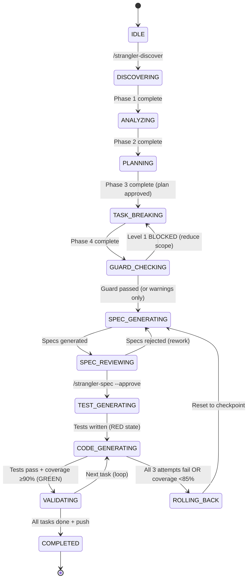
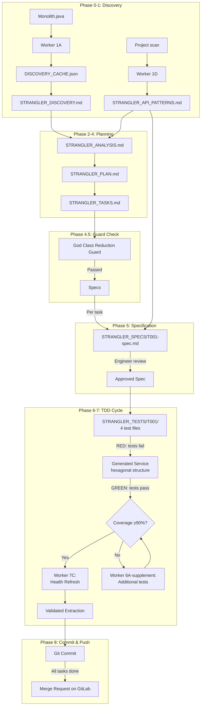
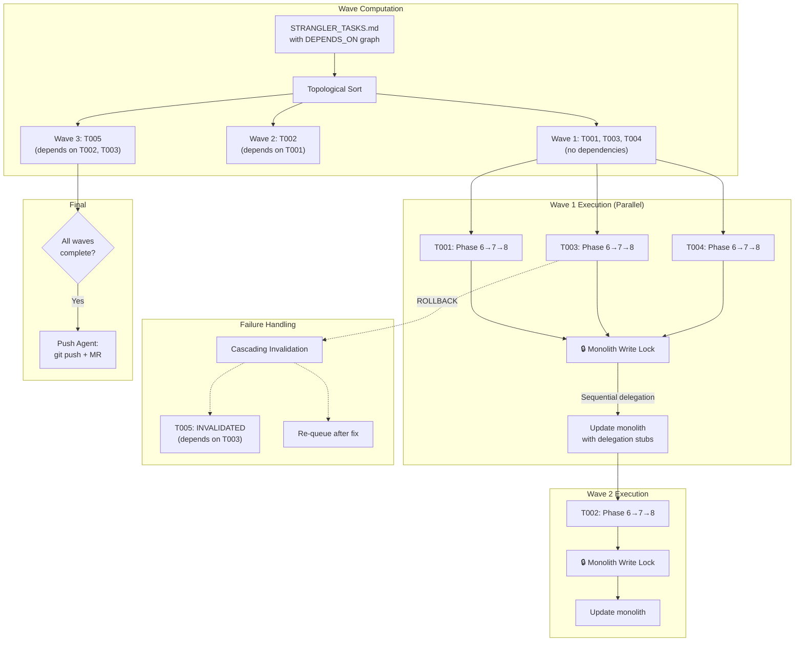
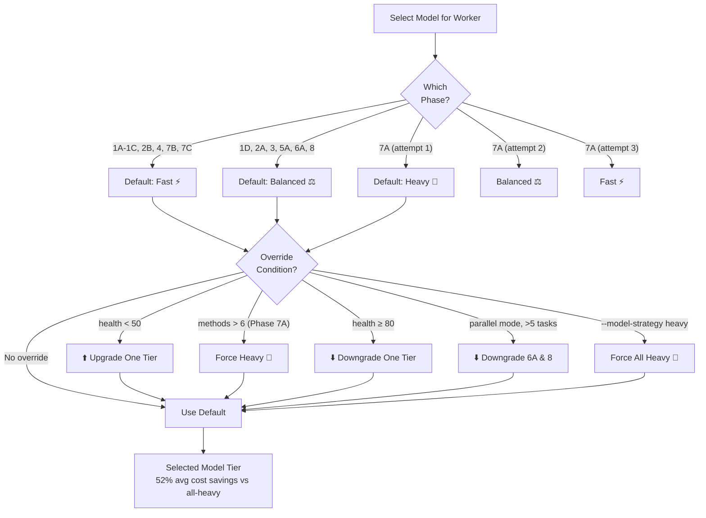

# Strangler Refactoring Plugin — Flow Diagram (v3.2)

## Complete 9-Phase Pipeline

```mermaid
flowchart TD
    %% ═══════════════════════════════════════════════════════
    %% COMMAND ENTRY POINTS
    %% ═══════════════════════════════════════════════════════
    
    CMD_DISCOVER["/strangler-discover\nMonolith.java --jira JIRA-ID\n[--dry-run] [--quick]"]
    CMD_PLAN["/strangler-plan"]
    CMD_TASKS["/strangler-tasks"]
    CMD_SPEC["/strangler-spec --all"]
    CMD_APPROVE["/strangler-spec --approve --all"]
    CMD_EXTRACT["/strangler-extract T001\n[--parallel] [--all] [--dry-run]\n[--model-strategy auto] [--override-guard]"]
    CMD_STATUS["/strangler-status"]

    %% ═══════════════════════════════════════════════════════
    %% DRY-RUN PREVIEW (v3.2)
    %% ═══════════════════════════════════════════════════════

    CMD_DISCOVER --> DRYRUN_D{--dry-run?}
    DRYRUN_D -->|Yes| PREVIEW_D[📋 Preview Report\nTarget analysis, phases,\ncost estimate → STOP]
    DRYRUN_D -->|No| P0

    CMD_EXTRACT --> DRYRUN_E{--dry-run?}
    DRYRUN_E -->|Yes| PREVIEW_E[📋 Preview Report\nPer-task impact, waves,\ncoverage predictions → STOP]
    DRYRUN_E -->|No| P6

    %% ═══════════════════════════════════════════════════════
    %% PHASE 0: SETUP
    %% ═══════════════════════════════════════════════════════
    
    P0{Phase 0:\nSetup}
    P0 --> P0_VALIDATE[Validate target file exists]
    P0_VALIDATE --> P0_BRANCH[Create branch:\nfeature/JIRA-strangler-extract]
    P0_BRANCH --> P0_STATE[Initialize forge-state.json]

    %% ═══════════════════════════════════════════════════════
    %% PHASE 1: DISCOVERY (4 Parallel Workers)
    %% ═══════════════════════════════════════════════════════
    
    P0_STATE --> P1{Phase 1:\nDiscovery}
    
    P1 --> W1A["Worker 1A (fast):\nStructure Analyzer"]
    W1A --> CACHE[(DISCOVERY_CACHE.json)]
    
    CACHE --> W1B["Worker 1B (fast):\nDomain Boundary Detector"]
    CACHE --> W1C["Worker 1C (fast):\nComplexity Metrics"]
    P1 --> W1D["Worker 1D (balanced):\nAPI Pattern Inspector"]
    
    W1B --> DISCOVERY_OUT[STRANGLER_DISCOVERY.md]
    W1C --> DISCOVERY_OUT
    W1D --> PATTERNS_OUT[STRANGLER_API_PATTERNS.md]

    %% ═══════════════════════════════════════════════════════
    %% PHASE 2-3: ANALYSIS & PLANNING
    %% ═══════════════════════════════════════════════════════
    
    DISCOVERY_OUT --> P2{Phase 2:\nAnalysis}
    PATTERNS_OUT --> P2
    CMD_PLAN --> P2
    
    P2 --> W2A["Worker 2A (balanced):\nPattern Analysis"]
    P2 --> W2B["Worker 2B (fast):\nTest Strategy"]
    
    W2A --> P3{Phase 3:\nPlanning}
    W2B --> P3
    P3 --> QUESTIONS["Interactive (balanced):\n5 Planning Questions"]
    QUESTIONS --> PLAN_OUT[STRANGLER_PLAN.md]

    %% ═══════════════════════════════════════════════════════
    %% PHASE 4: TASK BREAKDOWN
    %% ═══════════════════════════════════════════════════════
    
    CMD_TASKS --> P4{Phase 4:\nTask Breakdown}
    PLAN_OUT --> P4
    P4 --> TASKS_OUT[STRANGLER_TASKS.md\nT001, T002, T003...]

    %% ═══════════════════════════════════════════════════════
    %% PHASE 4.5: GOD CLASS REDUCTION GUARD (NEW v3.2)
    %% ═══════════════════════════════════════════════════════

    TASKS_OUT --> P45{Phase 4.5:\n🛡️ God Class\nReduction Guard}
    
    P45 --> GUARD_L1{Level 1:\nhealth<40 &\nmethods>8?}
    GUARD_L1 -->|Yes| BLOCKED[🚫 BLOCKED\nExtract smaller pioneer first\nor use --override-guard]
    GUARD_L1 -->|No| GUARD_L2{Level 2:\nAny task\n>10 methods?}
    GUARD_L2 -->|Yes| WARN_L2[⚠️ WARN:\nSuggest splitting]
    GUARD_L2 -->|No| GUARD_L3{Level 3:\nhealth<60 &\ntasks>5?}
    GUARD_L3 -->|Yes| WARN_L3[⚠️ WARN:\nRecommend phased waves]
    GUARD_L3 -->|No| P5
    WARN_L2 --> P5
    WARN_L3 --> P5

    %% ═══════════════════════════════════════════════════════
    %% PHASE 5: SPEC GENERATION
    %% ═══════════════════════════════════════════════════════
    
    CMD_SPEC --> P5{Phase 5:\nSpec Generation}
    
    P5 --> W5A["Worker 5A (balanced):\nSpec Generator\n+ reverse-spec-generator"]
    W5A --> SPEC_OUT[STRANGLER_SPECS/\n• .spec BDD YAML\n• Contract interface\n• DTOs\n• Behavior tables\n• Error contracts]
    
    SPEC_OUT --> PAUSE((⏸️ PAUSE\nEngineer Reviews\nSpecs))
    
    CMD_APPROVE --> APPROVED{Specs\nApproved?}
    PAUSE --> APPROVED
    APPROVED -->|No| P5
    APPROVED -->|Yes| P6

    %% ═══════════════════════════════════════════════════════
    %% PHASE 6: TEST GENERATION — RED
    %% ═══════════════════════════════════════════════════════
    
    P6{Phase 6:\nTest Generation\n🔴 RED}
    
    P6 --> W6A["Worker 6A (balanced):\nTest Generator"]
    W6A --> TEST_OUT[STRANGLER_TESTS/\n• Contract tests\n• Behavior tests\n• Integration tests\n• Error tests]
    
    TEST_OUT --> RED_STATE[Tests FAIL\n— expected RED state]

    %% ═══════════════════════════════════════════════════════
    %% PHASE 7: CODE GENERATION — GREEN
    %% ═══════════════════════════════════════════════════════
    
    RED_STATE --> P7{Phase 7:\nCode Generation\n🟢 GREEN}
    
    P7 --> ATTEMPT1["Attempt 1 (heavy):\nClean Code\n85-90% fidelity"]
    ATTEMPT1 --> W7B_1["Worker 7B (fast):\nRun Tests"]
    
    W7B_1 -->|Pass| COV_CHECK
    W7B_1 -->|Fail| ATTEMPT2["Attempt 2 (balanced):\nConservative\n93-97% fidelity"]
    
    ATTEMPT2 --> W7B_2["Worker 7B (fast):\nRun Tests"]
    W7B_2 -->|Pass| COV_CHECK
    W7B_2 -->|Fail| ATTEMPT3["Attempt 3 (fast):\nPure Movement\n>98% fidelity"]
    
    ATTEMPT3 --> W7B_3["Worker 7B (fast):\nRun Tests"]
    W7B_3 -->|Pass| COV_CHECK
    W7B_3 -->|Fail| ROLLBACK[🔄 AUTO-ROLLBACK\ngit reset --hard\nto checkpoint]

    %% ═══════════════════════════════════════════════════════
    %% PHASE 7 STEP 6.5: COVERAGE GATE (NEW v3.2)
    %% ═══════════════════════════════════════════════════════

    COV_CHECK{Coverage\n≥90%?}
    COV_CHECK -->|Yes| W7C
    COV_CHECK -->|No| W6A_SUP["Worker 6A-supplement (balanced):\nGenerate supplementary tests\nfor uncovered lines/branches"]
    W6A_SUP --> COV_RERUN["Re-run all tests"]
    COV_RERUN --> COV_RETRY{Coverage\n≥90%?\n(round 2)}
    COV_RETRY -->|Yes| W7C
    COV_RETRY -->|No, <85%| ROLLBACK
    COV_RETRY -->|No, ≥85%| W7C_WARN["⚠️ Proceed with warning"]
    W7C_WARN --> W7C

    %% ═══════════════════════════════════════════════════════
    %% WORKER 7C: HEALTH REFRESH (NEW v3.2)
    %% ═══════════════════════════════════════════════════════

    W7C["Worker 7C (fast):\nHealth Refresh\nRecalculate monolith metrics"]
    W7C --> P8

    %% ═══════════════════════════════════════════════════════
    %% PHASE 8: VALIDATION & COMMIT
    %% ═══════════════════════════════════════════════════════
    
    P8{Phase 8:\nValidation}
    
    P8 --> CHECK1["Check 1 (balanced):\nLogic Fidelity ≥85%"]
    CHECK1 --> CHECK2[Check 2:\nALL Tests Pass + Coverage ≥90%\n⭐ PRIMARY GATE]
    CHECK2 --> CHECK3[Check 3:\nNo Anti-Patterns\n≤15 methods, no cycles]
    
    CHECK3 --> GATE{Quality\nGate?}
    GATE -->|REJECTED| ROLLBACK
    GATE -->|APPROVED| COMMIT[Commit Task\nJIRA: extract T001]
    
    COMMIT --> MORE{More\nTasks?}
    MORE -->|Yes| NEXT_TASK[Next: /strangler-extract T002]
    NEXT_TASK --> P6
    MORE -->|No| PUSH[Push Agent:\ngit push + Create MR]

    %% ═══════════════════════════════════════════════════════
    %% STATUS (anytime)
    %% ═══════════════════════════════════════════════════════
    
    CMD_STATUS -.->|reads| STATE_FILE[(forge-state.json)]
    P0_STATE --> STATE_FILE
    
    %% ═══════════════════════════════════════════════════════
    %% STYLING
    %% ═══════════════════════════════════════════════════════
    
    classDef command fill:#1a73e8,color:#fff,stroke:#0d47a1
    classDef phase fill:#f9a825,color:#000,stroke:#f57f17
    classDef worker fill:#43a047,color:#fff,stroke:#2e7d32
    classDef artifact fill:#7b1fa2,color:#fff,stroke:#4a148c
    classDef decision fill:#e65100,color:#fff,stroke:#bf360c
    classDef pause fill:#d32f2f,color:#fff,stroke:#b71c1c
    classDef rollback fill:#c62828,color:#fff,stroke:#b71c1c
    classDef guard fill:#ff6f00,color:#fff,stroke:#e65100
    classDef preview fill:#546e7a,color:#fff,stroke:#37474f
    
    class CMD_DISCOVER,CMD_PLAN,CMD_TASKS,CMD_SPEC,CMD_APPROVE,CMD_EXTRACT,CMD_STATUS command
    class P0,P1,P2,P3,P4,P5,P6,P7,P8 phase
    class W1A,W1B,W1C,W1D,W2A,W2B,W5A,W6A,W7B_1,W7B_2,W7B_3,ATTEMPT1,ATTEMPT2,ATTEMPT3,W6A_SUP,W7C worker
    class CACHE,DISCOVERY_OUT,PATTERNS_OUT,PLAN_OUT,TASKS_OUT,SPEC_OUT,TEST_OUT,STATE_FILE artifact
    class APPROVED,GATE,MORE,DRYRUN_D,DRYRUN_E,COV_CHECK,COV_RETRY decision
    class PAUSE pause
    class ROLLBACK,RED_STATE rollback
    class P45,GUARD_L1,GUARD_L2,GUARD_L3,BLOCKED,WARN_L2,WARN_L3 guard
    class PREVIEW_D,PREVIEW_E preview
```

---

## Agent Interaction Model

```mermaid
flowchart LR
    subgraph Commands["Commands (Entry Points)"]
        C1[strangler-discover]
        C2[strangler-plan]
        C3[strangler-tasks]
        C4[strangler-spec]
        C5[strangler-extract]
        C6[strangler-status]
    end
    
    subgraph Hub["Orchestrator (Hub)"]
        ORCH[Orchestrator Agent\n• Sole state writer\n• Phase-gated skill loader\n• Quality gate enforcer\n• Model-aware dispatcher\n• Wave scheduler]
    end
    
    subgraph Spokes["Workers (Spokes)"]
        direction TB
        W_DISC[Discovery Workers\n1A, 1B, 1C, 1D]
        W_ANAL[Analysis Workers\n2A, 2B]
        W_SPEC[Spec Worker 5A]
        W_TEST[Test Workers\n6A, 6A-supplement]
        W_CODE[Code Workers\n7A, 7B, 7C]
    end
    
    subgraph Gates["Gatekeepers"]
        VAL[Validation Agent\n3-check gate\n+ 90% coverage]
        PUSH[Push Agent\ngit push + MR]
        AUTO[Auto-Decision\nAgent]
    end
    
    subgraph Skills["Domain Skills (Phase-Gated)"]
        direction TB
        S1[state-machine]
        S2[api-inspection]
        S3[spec-generation]
        S4[test-generation]
        S5[code-generation]
        S6[error-codes]
        S7[rollback]
        S8[branching-strategy]
        S9[model-aware-execution]
    end
    
    subgraph State["State"]
        SF[(forge-state.json)]
        MC[(MONOLITH_EXTRACTION\n_CACHE.json)]
        ART[(Artifact Files\nDISCOVERY.md\nAPI_PATTERNS.md\nSPECS/\nTESTS/)]
    end
    
    Commands -->|"delegate"| ORCH
    ORCH -->|"spawn\n(model-aware)"| Spokes
    ORCH -->|"invoke"| Gates
    ORCH -->|"read/write"| SF
    ORCH -->|"read/write"| MC
    ORCH -.->|"loads per phase"| Skills
    Spokes -->|"write"| ART
    Spokes -->|"NEVER write"| SF
    Spokes -.->|"uses skill_context"| Skills
    Gates -->|"read only"| ART
    VAL -->|"APPROVED/REJECTED"| ORCH
```



---

## State Machine Transitions



---

## Data Flow & Artifact Lifecycle



---

## Parallel Extraction Flow (v3.2)



---

## Model Selection Decision Tree (v3.2)



---

## Legend

| Symbol | Meaning |
|--------|---------|
| 🔵 Blue boxes | Commands (user entry points) |
| 🟡 Yellow diamonds | Phase transitions |
| 🟢 Green boxes | Worker agents (execution) |
| 🟣 Purple boxes | Artifacts (files produced) |
| 🔴 Red boxes | Pause/rollback points |
| 🟠 Orange boxes | God Class Reduction Guard gates |
| ⬛ Gray boxes | Dry-run preview (no execution) |
| ⭐ | Primary quality gate (tests must pass + coverage ≥90%) |
| ⏸️ | Human review required before proceeding |
| 🔄 | Auto-rollback on failure |
| 🛡️ | God Class Reduction Guard |
| 🔒 | Monolith write lock (parallel mode) |
| ⚡ | Fast model tier (Haiku) |
| ⚖️ | Balanced model tier (Sonnet) |
| 🧠 | Heavy model tier (Opus) |
